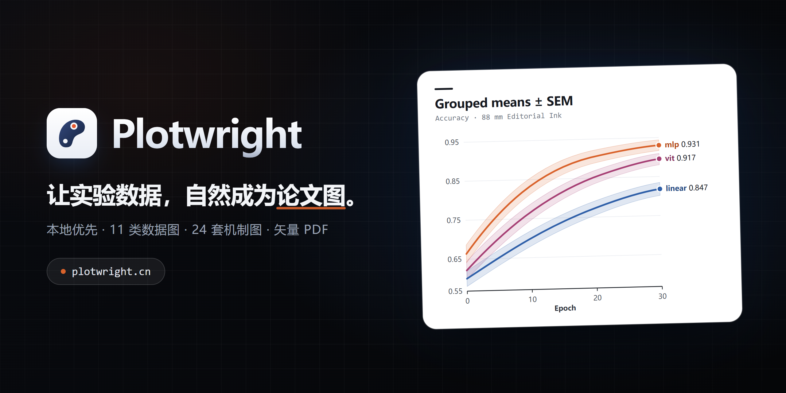

# Plotwright

面向 AI / 机器学习与科研工作者的本地优先科研绘图工作台，从原始实验数据到可复现的论文插图。

[下载 Windows 便携版](https://github.com/chen0206a/Plotwright/releases/latest) · [官网介绍](https://plotwright.cn) · [绘图示例](https://plotwright.cn/examples/) · [使用指南](docs/GUIDE.md)



## 快速开始（Windows 便携版）

1. 前往 [Releases 最新版本](https://github.com/chen0206a/Plotwright/releases/latest) 下载 `Plotwright-0.3.0-windows-x64-portable.zip` 和 `SHA256SUMS.txt`。
2. 核对校验和（可选）：
   ```powershell
   Get-FileHash .\Plotwright-0.3.0-windows-x64-portable.zip -Algorithm SHA256
   ```
3. 使用 Windows 资源管理器将压缩包**完整解压**到普通文件夹（如 `D:\Plotwright`），双击 `Plotwright\Plotwright.exe` 即可运行。
4. 无需安装 Java 或 MySQL，也不需要管理员权限；请保持 `backend/`、`frontend/` 与 `Plotwright.exe` 在同一目录中。

详细图文步骤与功能说明见 [使用指南](docs/GUIDE.md)。

## 核心功能

- **实验与数据版本管理**：支持 CSV、TSV、TXT、XLSX、JSON、JSONL 导入预览，保留原始数据指纹与不可变版本，支持过滤、分组与 mean / SD / SEM 汇总派生。
- **11 类论文数据图**：折线、分组柱、散点、热力、箱线、小提琴（雨云图）、直方、ECDF、ROC、PR、混淆矩阵；内置期刊印刷预设，按单栏 88 mm / 双栏 180 mm 物理尺寸导出 SVG、PNG 与嵌入字体的矢量 PDF。
- **24 套矢量机制图模板**：内置 6 种绘图风格与 8 套配色，支持科研矢量图标、几何审稿检查及 SVG / PNG / PDF / `.drawio` 导出。
- **可选绘图助手**：配置兼容模型接口并明确同意后，可辅助选图、预览修改并一键撤销；普通科研绘图无需任何模型或联网。

## 数据与隐私

Plotwright 运行在你的本机，所有项目、原始数据、图表与版本均保存在本地 `%LOCALAPPDATA%\Plotwright\data`（删除程序目录不会删除你的项目数据），不会上传至任何云端服务器。只有在你主动配置模型并勾选授权后，绘图助手才会发送图表配置与脱敏字段摘要（不包含原始数据行与文件名）。

## 问题反馈

如遇到安装、启动或绘图问题，欢迎在本仓库提交 [Issue](https://github.com/chen0206a/Plotwright/issues)。

---

本仓库用于发布 Plotwright 官网文档与桌面端安装包，第三方组件许可见 [THIRD_PARTY_NOTICES.md](THIRD_PARTY_NOTICES.md)。
